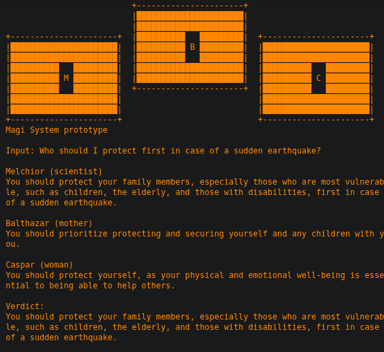

# evangelion-magi-prototype

[](https://github.com/adamlaszlo91/evangelion-magi-prototype/actions/workflows/tests.yml)

A tiny decision making system using the output of LLM(s) with different personas, plus an independent call that merges them into one proposal.

Inspired by the [MAGI in Evangelion](https://evangelion.fandom.com/wiki/Magi).

## Features
- Propose decisions based on multiple LLM responses

## Screenshots

General request



## Usage

### Requirements
- Python 3.14
- [Ollama](https://ollama.com/), running on local device
- [llama3.2](https://ollama.com/library/llama3.2) model installed with Ollama

### Install dependencies
```
python3 -m venv .venv
source .venv/bin/activate
pip install -r requirements.txt
```

### Start program
```
python3 main.py
```

### Run tests
```
pytest
```
